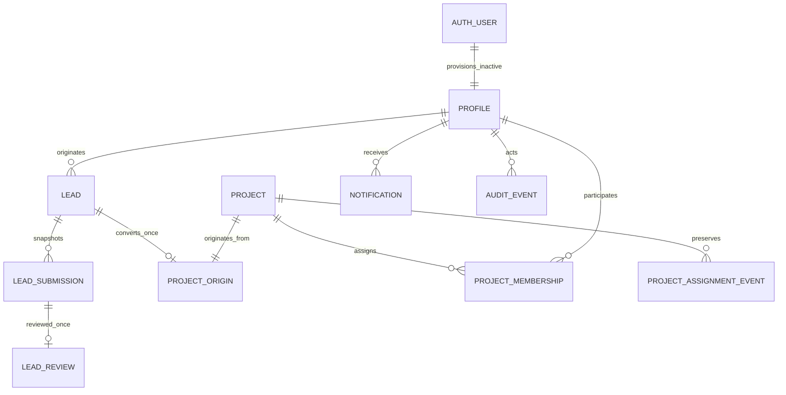

# Data model

Four migrations are applied to hosted One ODC and retained with matching versions:

1. `20261013065850_one_odc_foundation.sql`: roles, profiles, pipeline-safe projects, memberships, immutable audits and inactive-user trigger.
2. `20261013070524_phase1_workflow.sql`: lead lifecycle, immutable submission/review records, project origins, assignments, notifications, indexes, RLS and audited RPCs.
3. `20261013071132_rls_initplan.sql`: cache actor/role lookups in membership and notification RLS policies.

| Table                     | Purpose / constraints                                                                                                                        |
| ------------------------- | -------------------------------------------------------------------------------------------------------------------------------------------- |
| profiles                  | Auth UUID, display name, five-role enum, active flag; initially inactive Designer, never metadata-derived privilege                          |
| projects                  | Unique reference, name, Lead Designer, commercial enum and expected handoff; safe preview columns only                                       |
| project_memberships       | Project/user/role composite key; one primary per role, supports Lead self-assignment as Designer                                             |
| audit_events              | Actor/entity/Project, before/after JSON, action and database timestamp; immutable update/delete trigger                                      |
| leads                     | BDM owner, approved fields, metadata JSON, lifecycle enum, optimistic version, submission count, first/last submit and resolution timestamps |
| lead_submissions          | Unique lead/submission number, full immutable snapshot including duplicate override reason, submitter and timestamp                          |
| lead_reviews              | Unique submission link, reviewer/decision/remarks/time; return/reject remarks required; immutable                                            |
| project_origins           | Project PK, originating Lead UNIQUE, primary BDM; separated from Ops-safe preview                                                            |
| project_assignment_events | Actor, Project, reason, complete before/after membership snapshots and time; immutable                                                       |
| notifications             | Recipient, optional lead/Project link, generic message, created/read times; recipient-scoped                                                 |

Lead states are Draft → Submitted → Accepted/Returned for Clarification/Rejected; Returned can be edited/resubmitted. Accepted/Rejected are final in this phase. A retry of Accepted is idempotent. Drafts can omit required submission fields. Submission requires nonblank name/address and positive integer cabinetry count. Cabinetry count never generates Spaces or pricing.

Metadata is limited to five names/sizes/MIME types, at most 50 MiB per file under the completion migration and only `not_uploaded`. No bytes or provider IDs imply completed uploads. Draft history uses audit; full immutable snapshots are created on each submission. Lead age counts Asia/Manila calendar boundaries from first submission through resolution/current date.

All twelve business tables enable RLS. Every workflow mutation occurs through explicitly granted, actor-checked transactional RPCs. Foreign keys, review queues, histories and scoped duplicate lookups have indexes. Sequence gaps after rollback are expected and have no business meaning.

Spaces, quotations/version items, finance/payments, logistics, handoff, activities, expanded attachment associations and operational completion remain unmigrated. Commercial closure has no application mutation yet; its future transaction must require an active assigned Ops Admin.

## Private attachment migration

`20261013080433_private_attachments.sql` adds `attachments` and `attachment_versions` plus a private bucket and Storage RLS. Business tables contain no file contents.

- `attachments`: stable UUID, exactly one real Lead/Project foreign key, classification, actor/time and soft archive timestamp. Lead records currently use general classification. Future entity links require real foreign keys and role policies; arbitrary polymorphic IDs are deliberately not accepted.
- `attachment_versions`: version UUID, attachment FK, unique object path, original display name, MIME declaration, expected/actual size, uploader/time and verified-ready timestamp. A replacement adds a version, preserving all earlier paths. Storage UPDATE/DELETE has no user policy.
- Paths: `projects/{projectUUID}/attachments/{attachmentUUID}/versions/{versionUUID}` or pre-conversion `leads/{leadUUID}/attachments/{attachmentUUID}/versions/{versionUUID}`. Lead conversion does not rename/copy bytes; project-facing lead-attachment inheritance requires the scoped association work described in `storage-architecture.md`.
- Four actor-checked public invoker RPCs delegate privately: reserve, complete, archive/restore, record download request. Reservation locks the parent for the five-active-lead-file limit. Completion checks the provider's actual object-size metadata, never the browser's success claim alone.
- Read policies separate metadata, pending owner-only objects and ready objects. Archive removes object-read visibility but retains versions; restore checks scope and five-file capacity. Signed URLs already issued remain bearer capabilities until their short expiry.

The earlier JSON `leads.attachment_metadata` snapshots remain intact and explicitly not uploaded. They are not silently promoted or matched to files by name. Integrating the new relational attachments into submission snapshots is the next small Phase 1 task after real Auth/transfer acceptance.

## Phase 1 completion migrations

`20261013085045_phase1_file_limit.sql`: validates newly submitted file metadata and version sizes at 50 MiB, blocks submission with active unverified versions, and adds `uploaded_attachments` to immutable snapshots with stable attachment/version IDs, names and actual sizes. Legacy metadata remains `not_uploaded` and is never promoted implicitly.

`20261013090652_attachment_parent_locks.sql`: serializes reservation/archive against the Lead/Project parent, then rechecks write scope after waiting. Both are applied in staging; production application is pending. Staging's migration-version mapping is documented in `phase1-live-verification.md`; it includes the unrelated tracker's existing history.
